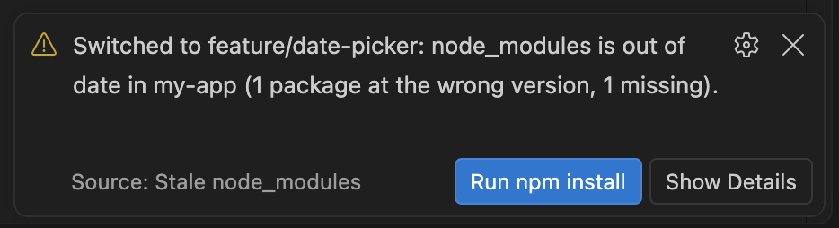

# Stale node_modules

A VS Code extension that warns you when a branch switch leaves `node_modules` out of date.

When HEAD moves in any open git repository (a checkout from VS Code or a terminal, a pull, or a rebase), it checks every npm project in that repo and, if anything changed, shows:



If you switch branches in a terminal outside VS Code, the warning appears when you come back to VS Code: its git integration waits for the window to be focused before it notices.

**Run npm install** opens a terminal in each affected directory and runs the command. **Show Details** opens the *Stale node_modules* output channel, which lists every package that differs.

## Install

Search for **Stale node_modules** in the Extensions view, or run:

```sh
code --install-extension PatSmuk.stale-node-modules
```

Also available on [Open VSX](https://open-vsx.org/extension/PatSmuk/stale-node-modules) for VSCodium, Cursor and other VS Code-compatible editors.

## What counts as out of date

The extension compares what's on disk; it doesn't just check whether the lockfile changed. Switching to a branch and back without installing in between gives no warning, because `node_modules` matches again.

- **Projects with `package-lock.json` / `npm-shrinkwrap.json`:** every package in the lockfile is compared with npm's record of what it installed (`node_modules/.package-lock.json`). It falls back to reading each installed `package.json` when that record is missing. The check catches:
  - a package at a different version
  - a missing package
  - a git dependency resolved to a different commit
  - a `package.json` (including npm workspace members) that disagrees with the lockfile
- **Projects without a lockfile:** each dependency in `package.json` must be installed, and exact versions (`1.2.3`) must match. Ranges aren't checked.

### What doesn't trigger a warning

- A directory with no `node_modules` at all. You never installed there, so there's nothing to go stale.
- A missing optional, platform-specific, peer-only or bundled package.
- Missing dev dependencies when none are installed, as after `npm install --omit=dev`.
- Leftover packages that the new branch no longer uses.
- A registry URL that differs only by host, such as from a mirror.
- yarn, pnpm and bun projects.
- The same problem reported twice. After you dismiss a warning, committing on the same branch won't raise it again until the mismatch changes.

The extension finds projects from the `package.json` files that git tracks, so it skips untracked ones.

## Commands and settings

- **Stale node_modules: Check Whether npm install Is Needed**: runs the check now, from the command palette.
- `staleNodeModules.installCommand` (default `npm install`): the command the button runs, for example `npm ci`.

## Development

Requires Node 22 (see `.nvmrc`).

```sh
npm install
npm test              # unit tests on synthetic fixtures, no network
npm run test:e2e      # real npm installs and branch switches (needs the registry)
npm run test:vscode   # opens a separate VS Code instance (throwaway profile) on a fixture repo
npm run package       # builds stale-node-modules-<version>.vsix
npm run icon          # re-renders images/icon.png from images/icon.svg
```

CI runs all three test suites on Linux, macOS and Windows. The extension relies on the built-in `vscode.git` extension and has no runtime dependencies.

### Releasing

1. Bump `version` in `package.json` and add a `CHANGELOG.md` entry.
2. Publish a GitHub release tagged `v<version>`.

The publish workflow checks the tag matches `package.json`, publishes to the VS Code Marketplace (Trusted Publishing, no token) and Open VSX (`OVSX_PAT` secret), and attaches the `.vsix` to the release.

## License

[MIT](LICENSE)
